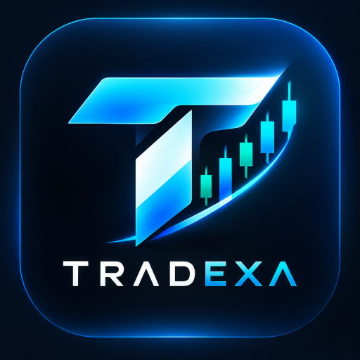
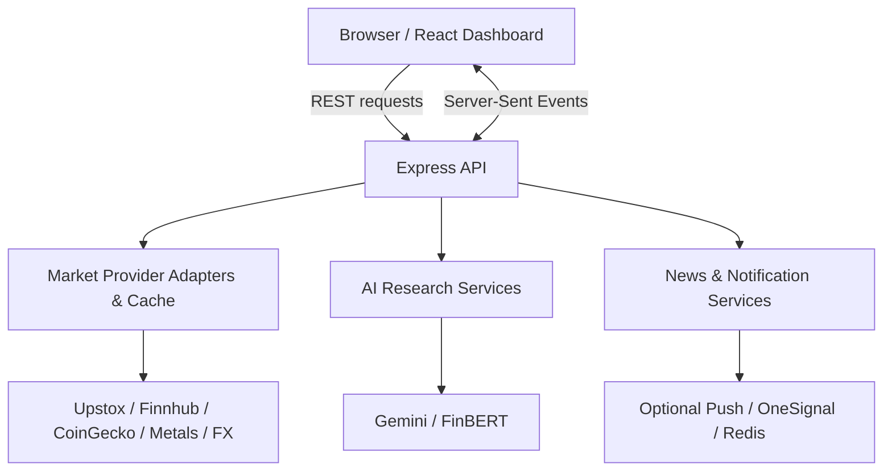

<div align="center">



# 📈 TRADEXA
### Global Markets Command Center

**Research smarter. Follow markets globally. Build in the open.**

[](https://ai-trading-lilac.vercel.app/)
[](https://github.com/Khatri-369/AI-TRADING/issues)
[](https://github.com/Khatri-369/AI-TRADING/pulls)
[](https://github.com/Khatri-369/AI-TRADING/stargazers)

**React 19 · TypeScript · Express · Vite · Tailwind CSS · Gemini · FinBERT**

[🌐 Live Application](https://ai-trading-lilac.vercel.app/) · [🐛 Report a Bug](https://github.com/Khatri-369/AI-TRADING/issues/new) · [💡 Suggest a Feature](https://github.com/Khatri-369/AI-TRADING/issues/new) · [🤝 Contribute](#-contributing)

</div>

---

## ✨ What is Tradexa?

**Tradexa** is an open-source, full-stack market intelligence dashboard combining provider-backed global market observations, charts, financial news, watchlists, and optional AI-assisted research in one interface.

The project prioritizes **data provenance over fake precision**: when a source is missing, delayed, unavailable, or stale, the UI should communicate that state instead of inventing a quote or market event.

> **Community-first:** Found a bug, spotted an improvement, or have an idea? Open an issue or submit a pull request. Thoughtful contributions of all sizes are welcome.

## 🚀 Features

| Area | Capabilities |
| --- | --- |
| 🌍 Global markets | Provider-backed India and US equities, crypto, metals, and forex reference data |
| 📊 Market charts | Historical charts where supported by the source and account entitlement |
| ⚡ Market streaming | Backend-managed Upstox WebSocket with normalized browser SSE updates |
| 📰 Financial news | News feeds with source-aware freshness and background alert integrations |
| 🧠 AI research | On-demand Gemini research chat and headline analysis; optional FinBERT sentiment |
| ⭐ Watchlists | Browser-local saved instruments and comparison tools |
| 🔔 Notifications | Optional web push and OneSignal-based news delivery, subject to configuration |
| 🔒 Secure integration | Backend-only provider credentials, validation, rate limits, and controlled AI access |
| 📱 Responsive interface | Dashboard designed for desktop and mobile screens |

**Important:** Data coverage, freshness, historical availability, and notification delivery depend on configured services and their permissions. Tradexa does **not** place trades.

## 🛠️ Tech stack

| Layer | Technologies |
| --- | --- |
| Frontend | React 19, TypeScript, Vite, Tailwind CSS 4 |
| Charts & UI | Lightweight Charts, Recharts, Lucide React, Motion |
| Backend | Node.js 22.14+, Express, TypeScript |
| Data transport | REST APIs, Server-Sent Events, WebSockets, Protobuf |
| Validation & security | Zod, Helmet, Express rate limiting |
| AI | Google Gemini, Hugging Face FinBERT |
| Market providers | Upstox, Finnhub, CoinGecko, Gold-API / GoldAPI, Frankfurter |
| Testing | Node test runner, Playwright, ESLint, TypeScript |
| Deployment | Vercel frontend, Node backend, Docker option |

## 🧩 Architecture



**Repository guide**

```text
.github/workflows/   CI workflows
server/              API routes, market adapters, AI and notification services
shared/              Shared types and instrument metadata
src/                 React components, hooks, pages and API clients
public/              Static assets
scripts/             Build and verification utilities
tests/browser/        Playwright browser tests
docs/                 Additional technical documentation
.env.example          Environment configuration template
```

## ⚙️ Quick start

**Prerequisites:** Node.js **22.14+**, npm, and API credentials for any optional providers you wish to enable.

```bash
# 1. Clone the project
git clone https://github.com/Khatri-369/AI-TRADING.git
cd AI-TRADING

# 2. Install dependencies
npm ci

# 3. Create your local environment file
cp .env.example .env

# 4. Start development
npm run dev
```

On Windows PowerShell, replace the copy command with `Copy-Item .env.example .env`.

Open **http://localhost:3000**. Add only the credentials for the integrations you plan to use. Restart the backend after changing `.env`.

### Environment configuration

| Variable | Purpose |
| --- | --- |
| `UPSTOX_ANALYTICS_TOKEN` | Read-only Indian market data and authorized streaming |
| `FINNHUB_API_KEY` | US quotes and financial news |
| `GEMINI_API_KEY` | On-demand AI research |
| `HUGGINGFACE_API_KEY` | FinBERT sentiment service |
| `COINGECKO_DEMO_API_KEY` | Optional CoinGecko access |
| `GOLD_API_KEY` | Optional GoldAPI.io integration |
| `AI_ACCESS_TOKEN` | Application-level access control for production AI |
| `BACKEND_ORIGIN` | Public origin of the always-on backend for frontend deployment |
| `VAPID_PUBLIC_KEY`, `VAPID_PRIVATE_KEY` | Optional web push |
| `ONESIGNAL_APP_ID`, `ONESIGNAL_REST_API_KEY` | Optional notification delivery |
| `UPSTASH_REDIS_REST_URL`, `UPSTASH_REDIS_REST_TOKEN` | Persistent news queue integration |

See [`.env.example`](.env.example) for the complete configuration and [DEPLOYMENT.md](DEPLOYMENT.md) for deployment details.

> 🔐 Never commit `.env`, provider tokens, private keys, or user data. Do not prefix private server credentials with `VITE_` or `PUBLIC_`.

## 🧪 Development commands

```bash
npm run dev           # Development server
npm run lint          # ESLint + typecheck
npm run typecheck     # TypeScript validation
npm test              # Automated backend tests
npm run build         # Production build
npm start             # Start production server
npm run test:browser  # Playwright tests (requires running server and Edge)
```

Provider-backed verification may consume API quota. Review `scripts/verify-live.ts` and the package scripts before running `npm run verify:live`.

## 🔌 Selected API endpoints

| Method | Endpoint | Purpose |
| --- | --- | --- |
| GET | `/api/health` | Process and sanitized provider health |
| GET | `/api/markets/overview` | Consolidated market overview |
| GET | `/api/markets/us` | US market observations |
| GET | `/api/markets/india` | Indian market observations |
| GET | `/api/markets/crypto` | Cryptocurrency observations |
| GET | `/api/markets/commodities` | Metals and commodities |
| GET | `/api/markets/forex` | FX reference rates |
| GET | `/api/markets/history/:symbol` | Supported historical observations |
| GET | `/api/stream/live-ticks` | SSE stream |
| GET | `/api/news` | Financial news |
| POST | `/api/ai/analyze` | On-demand headline analysis |
| POST | `/api/ai/chat` | Research chat |

Some endpoints require access controls, provider configuration, or rate-limit compliance. In production, AI access is gated by an application token. Consult source contracts for the current request schema.

## 🤝 Contributing

**Tradexa is built to improve with the community.** Whether you are fixing a typo, improving accessibility, adding tests, proposing a data adapter, or refining the user experience, your contribution matters.

1. Check [existing issues](https://github.com/Khatri-369/AI-TRADING/issues) and [pull requests](https://github.com/Khatri-369/AI-TRADING/pulls) to avoid duplicate work.
2. For substantial changes, open an issue first to discuss scope and data-provider implications.
3. Fork the repository and create a focused branch: `git checkout -b feat/your-feature`.
4. Implement the change, add appropriate tests, and run `npm run lint`, `npm test`, and `npm run build`.
5. Push your branch and [open a pull request](https://github.com/Khatri-369/AI-TRADING/compare) with a clear description and screenshots for UI changes.

**Great first contributions:** documentation improvements, bug reports with reproduction steps, accessible components, mobile layout fixes, test coverage, and improvements to stale/unavailable data messaging.

### Contribution principles

- **Never fabricate financial data.** Preserve source timestamps, freshness, and unavailable states.
- **Keep credentials private.** Provider API keys belong on the backend.
- **Respect provider terms.** Do not bypass quotas or redistribute restricted market data.
- **Keep changes reviewable.** Prefer small PRs with tests and a clear rationale.
- **Be respectful.** Give constructive feedback and assume good intent.

## 🗺️ Community roadmap

These are **ideas for discussion, not promised or implemented features**:

- [ ] Expand accessible, mobile-first dashboard experiences
- [ ] Improve source transparency and market-data diagnostics
- [ ] Add more provider adapters where licensing permits
- [ ] Expand test coverage and contributor documentation
- [ ] Explore configurable, permission-based research alerts
- [ ] Evaluate opt-in account sync with appropriate privacy controls

Have a better idea? [Start a feature discussion through an issue](https://github.com/Khatri-369/AI-TRADING/issues/new).

## 🛡️ Security and responsible use

- **Do not publish security vulnerabilities in a public issue.** Contact the maintainer privately or use GitHub private vulnerability reporting if enabled.
- Treat all AI-generated market commentary as **research assistance**, not verified investment advice.
- Quotes may be delayed, stale, incomplete, or unavailable; verify information with official sources before acting.
- No broker order placement or automated execution is included.
- Market-data licensing and redistribution rights are governed by each provider's agreement.

## 📄 License

**License status:** Check the repository for a `LICENSE` file before copying, modifying, or redistributing this code. Public GitHub visibility alone does not grant an open-source license. Maintainers should add an OSI-approved license (for example, MIT or Apache-2.0) if they intend to permit open-source reuse.

## 🌟 Support the project

If Tradexa helps you learn or build, consider **starring the repository**, sharing constructive feedback, or contributing a pull request.

<div align="center">

**Built with curiosity for markets, engineering, and open collaboration.**

[⭐ Star](https://github.com/Khatri-369/AI-TRADING) · [🐛 Issues](https://github.com/Khatri-369/AI-TRADING/issues) · [🤝 Pull Requests](https://github.com/Khatri-369/AI-TRADING/pulls)

<sub>Maintained by <a href="https://github.com/Khatri-369">Khatri-369</a> · Tradexa / AI-TRADING</sub>

</div>
